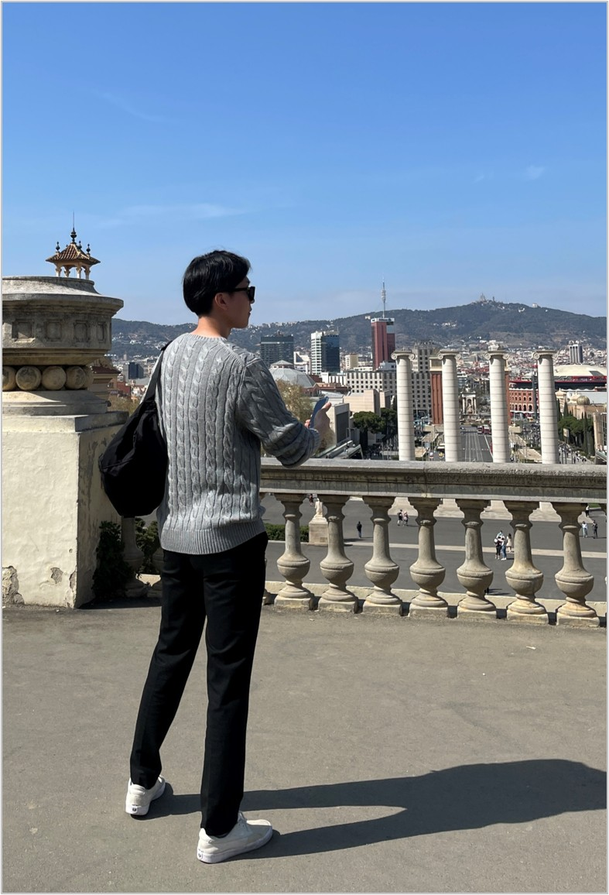

## About Me

- PhD student in School of Cybersecurity, Korea University
- Researcher at Digital Forensics Lab of Korea University

### Research Interests

- Cybersecurity 🛡️
- Digital Forensics 🎓
- Software Development 🛠️

### Links

---

## Experiences

2025.09 - 2026.02 | Visiting Student at Kellogg College, University of Oxford
2022.03 - Present | Full-time Researcher at Digital Forensics Lab, Korea University
2021.07 - 2021.12 | Intership Developer at WINS Co., Ltd.
2020.07 - 2021.03 | Digital Forensics Student at Best of the Best Program, KITRI

---

## Conference

### International

1. J. Lee, **G. Choi**, J. Han, and J. Park, "Advanced Monero Wallet Forensics: Demystifying Off-Chain Artifacts to Trace Privacy-Preserving Cryptocurrency Transactions", DFRWS APAC, 2025 
  [🔗](https://dfrws.org/presentation/advanced-monero-wallet-forensics-demystifying-off-chain-artifacts-to-trace-privacy-preserving-cryptocurrency-transactions/)
1. **G. Choi**, J. Bang, S. Lee, and J. Park, "*Chracer*: Memory analysis of Chromium-based browsers", DFRWS APAC, 2023 
  [🔗](https://dfrws.org/presentation/chracer-memory-analysis-of-chromium-based-browsers/) [📰]()
1. S. Cheon, **G. Choi**, and D. Kim, "A Cheating Attack on a Whitelist-based Anti-Ransomware Solution and its Countermeasure", IEEE ICCE, 2023 
  [🔗](https://doi.org/10.1109/ICCE56470.2023.10043480) [📰]()
1. D. Kim, **G. Choi**, and J. Lee, "White List-based Ransomware Real-time Detection and Prevention for User Device Protection", IEEE ICCE, 2018 
  [🔗](https://doi.org/10.1109/ICCE.2018.8326119) 

### Domestic

1. S. Yu, **G. Choi**, and J. Park, "Analysis of Man-in-the-Middle Attack Techniques and Approaches to Enhancing Incident Response Readiness in MCP-Based AI Systems", KDFS Conference on Summer (KDFS-S'26), 2026
1. N. Jeon, W. Yun, **G. Choi**, and J. Park, "A Study on Identifying File Activity Logs via Internal API Traffic Analysis of Cloud Storage Services", Conference on Information Security and Cryptography Summer (CISC-S'26), 2026
1. H. Gil, **G. Choi**, and J. Park, "LLM-Assisted Detection of Suspicious Conversations Using NER and RAG-Based Candidate Message Retrieval", KDFS Conference on Winter (KDFS-W'25), 2025
1. H. Park, **G. Choi**, and J. Park, "A Study on Automating Forensic Artifact Identification and Change Tracking for Electron-based Applications", KDFS Conference on Summer (KDFS-S'25), 2025
1. H. Park, **G. Choi**, and J. Park, "A Method for Tracking User’s Routes Based on Android Diagnostic Logs", KDFS Conference on Winter (KDFS-W'24), 2024
1. Y. Lee, **G. Choi**, and J. Park, "A Study on Methods for Identifying Traces of Web-Based Cryptocurrency Exchange Services", KDFS Conference on Winter (KDFS-W'24), 2024
1. S. Yun, **G. Choi**, W. Yun, and J. Park, "A Study on User Behavior Analysis Techniques Utilizing macOS Unified Logging Data", KDFS Conference on Summer (KDFS-S'24), 2024
1. H. Gwon, B. Jeong, **G. Choi**, and J. Park, "A study on collecting and normalizing potential digital evidence from Android devices using ADB commands", KDFS Conference on Summer (KDFS-S'23), 2023
1. **G. Choi**, J. Jeon, S. Jeong, E. Jo, Y. Hwang, H. Nam, K. Kim, and J. Kim, "Forensic analysis of Chinese automatic identification system", KDFS Conference on Winter (KDFS-W'20), 2020

---

## Journal

### International

1. J. Lee, **G. Choi**, J. Han, and J. Park, "Advanced Monero Wallet Forensics: Demystifying Off-Chain Artifacts to Trace Privacy-Preserving Cryptocurrency Transactions", Forensic Science International: Digital Investigation, Vol. 54 Supplement, 2025 
  [🔗](https://doi.org/10.1016/j.fsidi.2025.301988)
1. **G. Choi**, J. Bang, S. Lee, and J. Park, "*Chracer*: Memory analysis of Chromium-based browsers", Forensic Science International: Digital Investigation, Vol. 46 Supplement, 2023 
  [🔗](https://doi.org/10.1016/j.fsidi.2023.301613)

### Domestic

1. H. Park, **G. Choi**, and J. Park, "A Study on Automating Forensic Artifact Identification and Change Tracking for Electron-based Applications", Journal of Digital Forensics, Vol. 19, No. 4, 2025 
  [🔗](https://doi.org/10.22798/KDFS.2025.19.4.81)
1. Y. Jeon, **G. Choi**, and J. Park, "A Study on Forensic Analysis Methods for STT (Speech-To-Text) Applications in Android Environments", Journal of The Korea Institute of Information Security and Cryptology, Vol. 35, No. 4, 2025 
  [🔗](https://www.kci.go.kr/kciportal/landing/article.kci?arti_id=ART003233052)
1. Y. Lee, **G. Choi**, and J. Park, "A Study on Methods for Identifying Traces of Web-Based Cryptocurrency Exchange Services", Journal of Digital Forensics, Vol. 19, No. 2, 2025 
  [🔗](https://doi.org/10.22798/kdfs.2025.19.2.99)
1. S. Yun, **G. Choi**, and J. Park, "A Study on User Behavior Analysis Techniques Leveraging macOS's Apple Unified Log", Journal of Digital Forensics, Vol. 18, No. 5, 2024 
  [🔗](https://doi.org/10.22798/KDFS.2024.18.5.50)
1. H. Gwon, B. Jeong, **G. Choi**, and J. Park, "Research on Method for Analyzing and Normalizing Android Diagnostic Logs for Digital Forensics", Journal of Digital Forensics, Vol. 17, No. 3, 2023 
  [🔗](https://doi.org/10.22798/KDFS.2023.17.3.52)
1. J. Choi, **G. Choi**, and S. Lee, "Tracing Copyright Infringement Activities through Illegal Streaming Device Protocol Analysis", Journal of Digital Forensics, Vol. 17, No. 2, 2023 
  [🔗](https://doi.org/10.22798/KDFS.2023.17.2.62)
1. S. Jeong, **G. Choi**, J. Jeon, E. Jo, Y. Hwang, H. Nam, K. Kim, and J. Kim, "Collection and Analysis Methods of Automatic Identification System Artifacts", Journal of Digital Forensics, Vol. 15, No. 1, 2021 
  [🔗](https://doi.org/10.22798/KDFS.2021.15.1.95)

--- 

## Presentations

- "Development of Off-Chain Data Forensic System Against Cryptocurrency Transaction Obfuscation", ROK-U.S. Joint Seminar for Development of Digital Asset Transaction Tracking Techology to Prevent Malicious Financial Activities in the Digital Asset Market, 2026 
  [📰]()
- "Investigation of copyright infringment site usage traces through memory forensics", KSIE Conference on Fall, 2023
- "*Chracer*: Memory analysis of Chromium-based browsers", DFRWS APAC, 2023 
  [📰]()
- "Hands-on Training for Memory Forensics", Digital Forensics Workshop for Anti-Forensics Technology (held by DFRC at Korea University and Plainbit Co., Ltd.), 2023
- "A study on collecting and normalizing potential digital evidence from Android devices using ADB commands", KDFS Conference on Summer, 2023
- "A Cheating Attack on a Whitelist-based Anti-Ransomware Solution and its Countermeasure", IEEE ICCE, 2023 
  [📰]()
- "Analysis of EVBOX Streaming and VOD Application", Korea University Copyright Digital Forensics Seminar (held by School of Cybersecurity, Korea University and Korea Copyright Protection Agency), 2022
- "File Access Monitoring using File System Filter Driver", U.U.U Workshop, 2017

---

## Other Activities

- Exhibitor of "Digital Forensic Solution for Counter Anti-Forensics", Korea Police World Expo 2024 at Incheon, South Korea
- Exhibitor of "Digital Forensic Solution for Counter Anti-Forensics", Korea Police World Expo 2023 at Incheon, South Korea
- Exhibitor of "Digital Forensic Solution for Counter Anti-Forensics", Korea Police World Expo 2022 at Incheon, South Korea

---

## Prizes and Honors

- Best Poster, DFRWS APAC, 2025  
  Paper: "LLM-Assisted Detection of Suspicious Conversations Using NER and RAG-Based Candidate Message Retrieval" 
- Best Paper (issued by Commissioner General of Korea Coast Guard), KDFS-W'25, 2025  
  Paper: "LLM-Assisted Detection of Suspicious Conversations Using NER and RAG-Based Candidate Message Retrieval"
- Winner (1st place), DFRWS ICS Challenge, 2025
- Best Paper (issued by President of KDFS), KDFS-S'25, 2025  
  Paper: "A Study on Automating Forensic Artifact Identification and Change Tracking for Electron-based Applications"
- Best Paper (issued by Commissioner General of Korean National Police Agency), KDFS-W'24, 2024  
  Paper: "A Study on Methods for Identifying Traces of Web-Based Cryptocurrency Exchange Services"
- Best Paper (issued by Commissioner General of Korean National Police Agency), KDFS-S'23, 2023  
  Paper: "A study on collecting and normalizing potential digital evidence from Android devices using ADB commands"
- Excellence Prize (2nd place), Cyber Security AI·BigData Challenge, 2022
- Top Prize (1st place), Cyber Security AI·BigData Challenge, 2021
- BEST 10, KITRI Best of the Best (BoB) Program, 2021
- Best Paper (issued by President of KDFS), KDFS-W'20, 2020  
  Paper: "Forensic analysis of Chinese automatic identification system"
- Participation Prize, KDFS Digital Forensics Challenge, 2020
- Bronze Medal (3rd place), The 49th National Skills Competition, 2014
- Bronze Prize (3rd place), NetRiders Korea 2014 - The 10th Skill Competition, 2014
- Excellence Prize, The 48th National Skills Competition, 2013

---

## Projects

- Research on AI-Based Log Analysis Technology for Initial Response to Personal Data Breach Incidents 
  개인정보 유출사고 초동대응 특화 기반 로그 AI 통합분석 기술 연구 
  
  
  
- Empirical Analysis of Privacy Risks in Agentic AI 
  에이전틱 AI 분야 개인정보 침해위험 실증분석 
  
  
  
- Development of Forensic Technologies for On-Device AI Models 
  온디바이스 인공지능 모델 대상 포렌식 기술개발 
  
  
  
- On-site preprocessing-based Anti-Anti-Forensics Data Analysis Technology 
  현장 선처리 기반 안티-포렌식 대응 데이터 분석기술 
  
  
  
  
- Development of Digital Asset Transaction Tracking Technology to Prevent Malicious Financial Conduct in the Digital Asset Market 
  디지털 자산 시장에서의 악의적 금융 행위 방지를 위한 디지털 자산 거래 추적기술 개발 
  
  
  
- Research on Data Acquisition and Analysis for Counter Anti-Forensics 
  안티-포렌식 기술 대응을 위한 데이터 획득 및 분석 기술 연구 
  
  
  
  
- Development of Digital Evidence Analysis Technique Using Artificial Intelligence Technology 
  인공지능 기술 활용 디지털증거 분석 기법 개발 
  
  
  

---

## Education

- PhD, Korea University (2024 - Present)
- MS, Korea University (2022 - 2024)
- BE, University of Suwon (2016 - 2022)

  
Sections

  <nav aria-label="Shortcuts">
    <a href="#about-me">About Me</a>
    <a href="#experiences">Experiences</a>
    <a href="#conference">Conference</a>
    <a href="#journal">Journal</a>
    <a href="#presentations">Presentations</a>
    <a href="#other-activities">Other Activities</a>
    <a href="#prizes-and-honors">Prizes and Honors</a>
    <a href="#projects">Projects</a>
    <a href="#education">Education</a>
  </nav>

